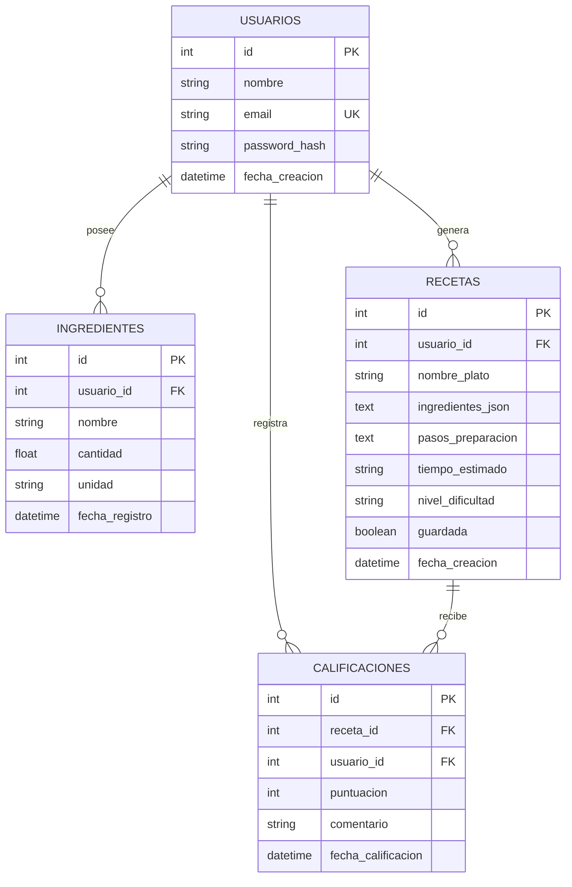

# SmartChef IA — Generador de Recetas con Inventario e IA

Aplicación web full-stack que permite a los usuarios registrar el inventario de ingredientes disponibles en casa y generar recetas estructuradas en formato JSON mediante un servicio interno conectado a un modelo de lenguaje (LLM) a través de OpenRouter, almacenándolas en base de datos para consultarlas, guardarlas, calificarlas (de 1 a 5 estrellas) o eliminarlas.

Repositorio oficial: https://github.com/Jbolivar05/ParcialFinal

---

## Tecnologías Utilizadas

- **Backend:** Python, FastAPI, Uvicorn, SQLAlchemy 2.0, Pydantic v2
- **Seguridad:** Autenticación JWT (`HS256`) y hashing criptográfico `PBKDF2-HMAC-SHA256`
- **Base de Datos:** MySQL 8.0 (producción / Docker) y SQLite (desarrollo y pruebas)
- **Integración IA:** Servicio interno encapsulado con OpenRouter API (`httpx`)
- **Frontend:** HTML5, Jinja2, CSS3 responsivo, Fetch API JavaScript y `favicon.ico`
- **Pruebas Unitarias:** `pytest` (10 pruebas automatizadas)
- **Despliegue:** Docker, Docker Compose y Cloudflare Tunnel (SSL/HTTPS válido)

---

## Estructura del Proyecto

```text
proyectofinal/
├── app/
│   ├── __init__.py
│   ├── main.py
│   ├── configuracion.py
│   ├── base_datos.py
│   ├── seguridad.py
│   ├── models/
│   │   ├── __init__.py
│   │   ├── usuario.py
│   │   ├── ingrediente.py
│   │   ├── receta.py
│   │   └── calificacion.py
│   ├── routers/
│   │   ├── __init__.py
│   │   ├── autenticacion.py
│   │   ├── ingredientes.py
│   │   └── recetas.py
│   ├── services/
│   │   ├── __init__.py
│   │   └── llm_service.py
│   ├── schemas/
│   │   ├── __init__.py
│   │   ├── usuario.py
│   │   ├── ingrediente.py
│   │   ├── receta.py
│   │   └── calificacion.py
│   └── templates/
│       └── index.html
├── tests/
│   ├── __init__.py
│   ├── conftest.py
│   ├── test_validacion_ingredientes.py
│   ├── test_servicio_llm.py
│   └── test_endpoints_api.py
├── static/
│   ├── favicon.ico
│   ├── css/estilos.css
│   └── js/aplicacion.js
├── docker-compose.yml
├── Dockerfile
├── .env.example
├── pytest.ini
├── README.md
└── requirements.txt
```

---

## Modelo de Base de Datos (4 Tablas)



---

## Endpoints de la API REST

La documentación interactiva OpenAPI/Swagger se encuentra disponible en `/docs`.

| Método | Endpoint | Descripción | Autenticación |
| :--- | :--- | :--- | :---: |
| `POST` | `/api/autenticacion/registro` | Registro de usuario y generación de token JWT | No |
| `POST` | `/api/autenticacion/iniciar-sesion` | Inicio de sesión y generación de token JWT | No |
| `GET` | `/api/autenticacion/perfil` | Información del usuario autenticado | Bearer JWT |
| `GET` | `/api/ingredientes` | Listar ingredientes del inventario personal | Bearer JWT |
| `POST` | `/api/ingredientes` | Crear ingrediente en el inventario | Bearer JWT |
| `GET` | `/api/ingredientes/{id}` | Obtener detalle de un ingrediente | Bearer JWT |
| `PUT` | `/api/ingredientes/{id}` | Actualizar ingrediente del inventario | Bearer JWT |
| `DELETE` | `/api/ingredientes/{id}` | Eliminar ingrediente del inventario | Bearer JWT |
| `POST` | `/api/recetas/generar` | Generar receta con IA desde el inventario actual | Bearer JWT |
| `GET` | `/api/recetas` | Listar historial de recetas generadas | Bearer JWT |
| `GET` | `/api/recetas/{id}` | Obtener detalle de una receta | Bearer JWT |
| `PATCH` | `/api/recetas/{id}/guardar` | Marcar o desmarcar receta como guardada | Bearer JWT |
| `POST` | `/api/recetas/{id}/calificar` | Calificar una receta de 1 a 5 estrellas | Bearer JWT |
| `DELETE` | `/api/recetas/{id}` | Eliminar una receta del historial | Bearer JWT |
| `GET` | `/api/salud` | Estado de salud del servidor | No |

---

## Configuración e Instalación Local

1. Clonar el repositorio y activar el entorno virtual:
   ```powershell
   git clone https://github.com/Jbolivar05/ParcialFinal.git
   cd ParcialFinal
   python -m venv .venv
   .\.venv\Scripts\Activate.ps1
   pip install -r requirements.txt
   ```

2. Crear el archivo `.env` a partir de `.env.example` y configurar las variables (`DATABASE_URL`, `JWT_SECRET_KEY`, `LLM_API_KEY`, `LLM_API_URL`, `LLM_MODEL`).

3. Iniciar el servidor de desarrollo:
   ```powershell
   uvicorn app.main:app --reload
   ```

---

## Ejecución de Pruebas Unitarias

```powershell
pytest
```

---

## Despliegue con Docker Compose y Cloudflare Tunnel

```powershell
docker compose up -d --build
```
